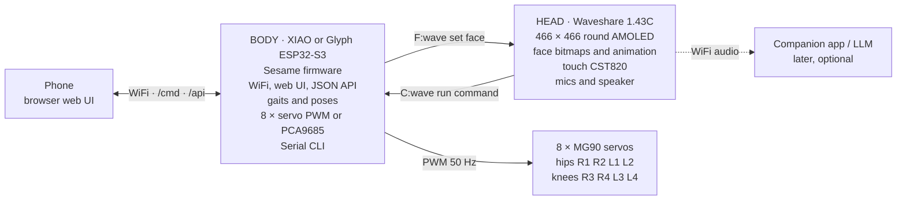
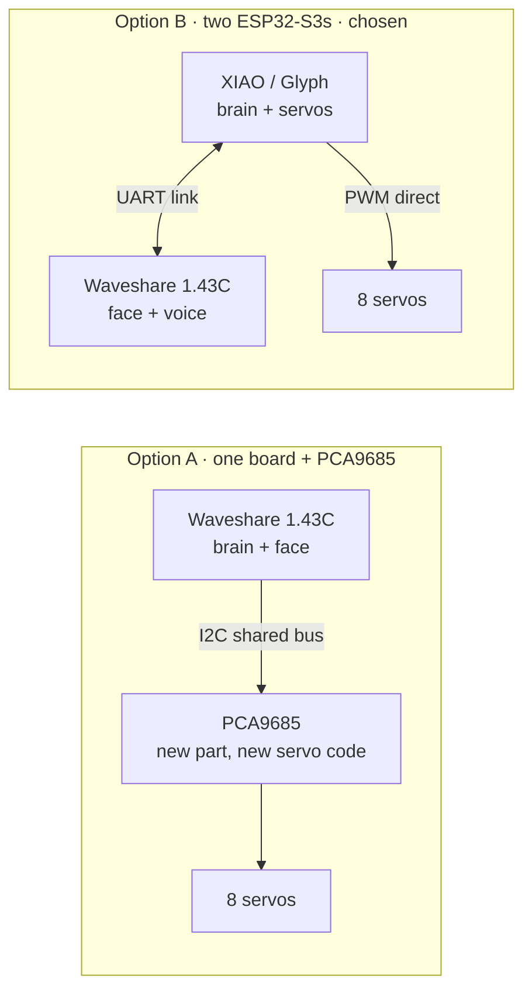
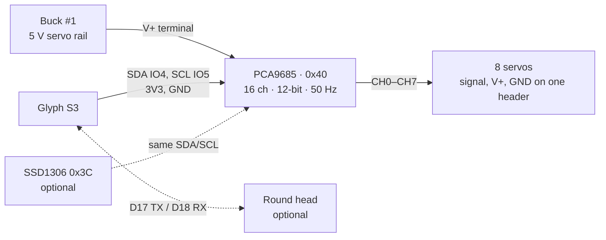
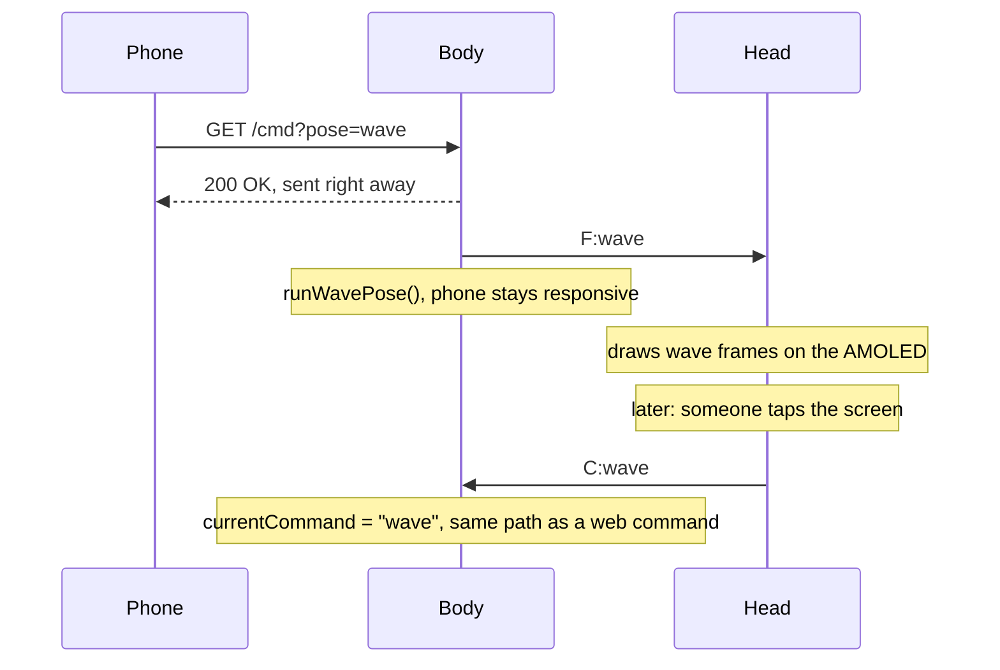
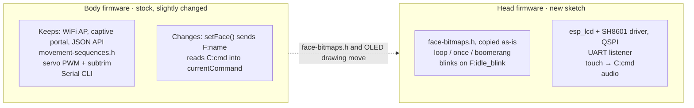
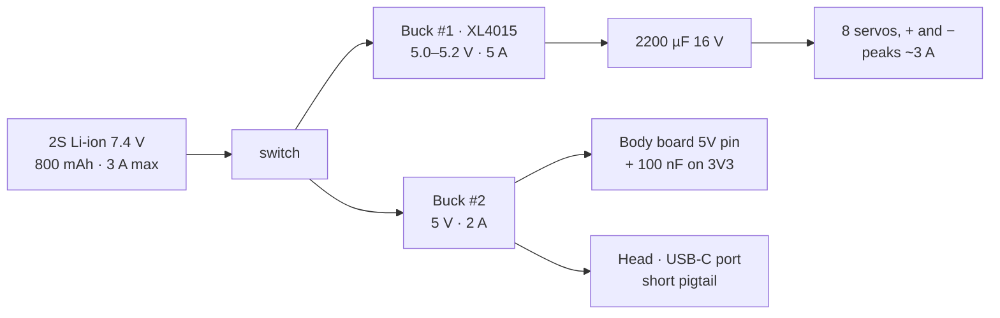
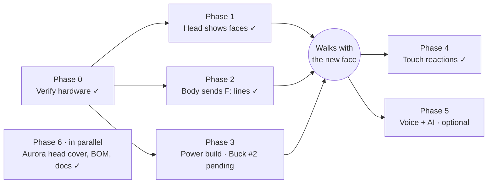

# Two-brain build: a body board and a head board

This is the design record for the fork's two-board Sesame. A body board (Seeed XIAO ESP32-S3 or PCBCupid Glyph ESP32-S3) keeps running the stock firmware and the 8 servos. A Waveshare ESP32-S3-Touch-AMOLED-1.43C becomes the head: a 466 × 466 round AMOLED face with touch, microphones and a speaker. Three wires connect them.

The firmware side is documented in [firmware/README.md](../../firmware/README.md) (board detection, `XIAO_HEAD_LINK`, `GLYPH_HEAD_LINK`, `USE_PCA9685`) and [firmware/head-firmware/README.md](../../firmware/head-firmware/README.md). The printed head is the [Aurora head](../../hardware/printing/stl/top-covers/aurora-head/README.md); the concept studies that led to it are in [design-options.md](../../hardware/printing/stl/top-covers/aurora-head/design-options.md). This page keeps the reasoning, the wiring, the power maths and the lessons learned.

## Status

| Item | State |
| --- | --- |
| XIAO ESP32-S3 port | Merged into `main`; all 8 servos verified with the wiring tester |
| Glyph ESP32-S3 port | Merged into `main`; direct-PWM and PCA9685 builds both run on hardware |
| Head | Shows all 36 faces; a tap on the head triggers a body trick over the link |
| R3/L4 knee bug | Fixed; PCA9685 pulses capped at 2400 µs (see below) |
| Aurora head v200 | CAD generator, STLs and top cover in the repo |
| Servo calibration | In progress |
| Battery | Must be 2S 7.4 V; current figures below are estimates, not measurements |

## Who does what



The body runs the robot and the head runs the face. Only face names and commands cross the UART link, never pixels. If the head is unplugged the robot still walks.

## Why two boards instead of one

The 1.43C exposes only I2C, UART and USB pads, with no free pins for 8 servos. Each option has to add something.



| | A · one board + PCA9685 | B · two ESP32-S3s |
| --- | --- | --- |
| Extra parts | PCA9685 servo driver | None |
| Servo code | Rewrite for PCA9685 | Existing code, compiles |
| Walking vs. display/audio load | Share one chip | Separate chips, walking stays smooth |
| Firmware | One program | Two programs plus a message format |
| Wiring and space | Less | More, two boards to fit |
| Risk | The ES7210 mic chip on the 1.43C may already use I2C address 0x40 | None |

Option B was built. The PCA9685 later came back as an optional body-side variant, where it has its own I2C bus and no address clash.

## XIAO pin map

Hips on D0–D3 and knees on D4, D5, D8 and D9, in the firmware's own servo order, so the servo GPIOs run 1 to 8. The head link uses D6/D7, the XIAO's hardware serial pins. No servo sits on a boot-log pin, so nothing twitches at reset.

| Index | Servo | Joint | XIAO pin | GPIO |
| --- | --- | --- | --- | --- |
| 0 | R1 | Front-right hip | D0 | 1 |
| 1 | R2 | Rear-right hip | D1 | 2 |
| 2 | L1 | Front-left hip | D2 | 3 |
| 3 | L2 | Rear-left hip | D3 | 4 |
| 4 | R4 | Rear-right knee | D4 | 5 |
| 5 | R3 | Front-right knee | D5 | 6 |
| 6 | L3 | Front-left knee | D8 | 7 |
| 7 | L4 | Rear-left knee | D9 | 8 |
| – | Link TX | to head RXD (GPIO44) | D6 | 43 |
| – | Link RX | from head TXD (GPIO43) | D7 | 44 |
| – | Spare | | D10 | 9 |

Cross TX to RX: the XIAO's D6 goes to the head's RXD pad (GPIO44), and the head's TXD pad (GPIO43) goes to the XIAO's D7. Only the servo signal wires go to the XIAO; their + and − go to the servo power rail. The head's pads are inside its case next to the USB-C port. Note that `XIAO_REVERSE_BODY` (default 1) swaps front and rear in software by reordering `servoPins` diagonally; the table above is the original orientation.

```cpp
// Servo order from movement-sequences.h: R1 R2 L1 L2 R4 R3 L3 L4
const int servoPins[8] = {1, 2, 3, 4, 5, 6, 7, 8};

// Link to the head: RX = D7 (GPIO44), TX = D6 (GPIO43)
Serial1.begin(115200, SERIAL_8N1, 44, 43);
```

### XIAO with a PCA9685

The XIAO still runs the robot, but a PCA9685 makes the servo pulses over I2C on D4 (SDA) and D5 (SCL). The head link stays on D6/D7, and D0–D3 and D8–D10 come free for sensors.

| | Direct PWM | With PCA9685 |
| --- | --- | --- |
| Extra parts | None | PCA9685 board |
| Free XIAO pins | 1 (D10) | 7 (D0–D3, D8–D10) |
| Servo channels | 8, all used | 16, 8 spare |
| ESP32 timer limit | More PWM devices can break WiFi | Not an issue |
| Servo power wiring | Separate rail to 8 servo plugs | One screw terminal, 3-pin headers |

## Glyph S3 pin map

The Glyph S3 has more pins, so it can drive all 8 servos and the original SSD1306 OLED at the same time. The firmware recognises the board from the Arduino board menu ("Pcbcupid GLYPH S3"). Pin names are the Glyph's silkscreen.

| Index | Servo / part | Joint / pin | Glyph pin | GPIO |
| --- | --- | --- | --- | --- |
| 0 | R1 | Front-right hip | A6 | 6 |
| 1 | R2 | Rear-right hip | A7 | 7 |
| 2 | L1 | Front-left hip | A8 | 8 |
| 3 | L2 | Rear-left hip | A9 | 9 |
| 4 | R4 | Rear-right knee | A10 | 10 |
| 5 | R3 | Front-right knee | D13 | 13 |
| 6 | L3 | Front-left knee | D14 | 14 |
| 7 | L4 | Rear-left knee | D15 | 15 |
| – | OLED SDA / SCL | `GLYPH_HEAD_LINK=0` | SDA / SCL | 4 / 5 |
| – | OLED VCC / GND | | 3V3 / GND | – |
| – | Head link TX | to head RXD, `GLYPH_HEAD_LINK=1` | D17 | 17 |
| – | Head link RX | from head TXD | D18 | 18 |
| – | Spare | | A2, D16, SCK, MO, MI | 2, 16, 35–37 |

```cpp
// Board menu: "Pcbcupid GLYPH S3" (or "... S3 PSRAM"), USB CDC On Boot: Enabled
#define GLYPH_HEAD_LINK 0   // 0 = OLED on SDA/SCL, 1 = round head on D17/D18

// Set by the firmware for the Glyph: R1 R2 L1 L2 R4 R3 L3 L4
const int servoPins[8] = {6, 7, 8, 9, 10, 13, 14, 15};
```

Cautions:

- **The servos can't run from the Glyph.** Its 3V3 regulator gives about 900 mA peak; eight servos peak around 3 A. Feed servo + and − from the 5 V servo rail and join that rail's ground to the Glyph's GND.
- **Powering the Glyph.** USB-C, or 5 V from the logic converter into the VB pin. Unplug the battery before connecting USB.
- **Keep A1 free.** IO1 is the battery-sense divider when the MSR jumper is shorted. Keep IO21 (LED) and IO43/44 (USB serial) free too.
- **The OLED runs on 3.3 V.** No level shifter needed.

### Glyph S3 with a PCA9685

Build with `-DUSE_PCA9685=1` (needs the Adafruit PWM Servo Driver Library). Four wires go from the Glyph to the PCA9685: SDA (IO4), SCL (IO5), 3V3 and GND. The eight servos plug into channels 0–7 and servo power goes into the V+ screw terminal. The OLED (0x3C) can share the bus with the PCA9685 (0x40), or the round head stays on D17/D18.



| Glyph pin | GPIO | PCA9685 pin | Carries |
| --- | --- | --- | --- |
| SDA | 4 | SDA | I2C data |
| SCL | 5 | SCL | I2C clock |
| 3V3 | – | VCC | Logic power |
| GND | – | GND | Common ground |
| – | – | OE | Leave open |
| Buck #1 +5 V | – | V+ terminal | Servo power, never from the Glyph |
| Buck #1 − | – | GND terminal | Servo ground, joined to the Glyph GND |

Servo index *i* goes to channel `pcaChannels[i]`, which defaults to 0–7 in the same R1 R2 L1 L2 R4 R3 L3 L4 order.

```cpp
#define USE_PCA9685 1       // servos on the PCA9685 at 0x40, SDA=IO4 / SCL=IO5
#define GLYPH_HEAD_LINK 1   // 1 = round head on D17/D18, 0 = OLED on the same I2C bus
const uint8_t pcaChannels[8] = {0, 1, 2, 3, 4, 5, 6, 7};
```

Cautions:

- **Never feed V+ from the Glyph.** Some breakouts have a jumper linking VCC and V+; leave it open.
- **Address 0x40.** Leave the A0–A5 pads unsoldered. The PCA9685 also answers 0x70 (all-call).
- **If the board doesn't answer** the firmware prints `PCA9685 not found at 0x40` and keeps running with the servos limp. Check SDA/SCL, VCC and GND.
- **Angles slightly off on every servo?** The firmware assumes a 27 MHz oscillator (`PCA9685_OSC_HZ`). Trim that before touching subtrims.
- **Add a capacitor on V+.** 470–1000 µF across V+ and GND.

## Why R3 and L4 didn't move in stand (lesson learned, 20 Oct 2026)

On the first Glyph + PCA9685 build, six servos moved into stand and two knees, R3 and L4, stayed still. Stand sends those knees to 180°, and the PCA build turned 180° into a 2929 µs pulse. These servos ignore anything above about 2400 µs, so they never moved.

The stock robot never had the problem because ESP32Servo quietly clamps `attach(732, 2929)` to a 2500 µs maximum. The PCA9685 code copied the 2929 constant, not the real behaviour.

| Build | Pulse range sent | Result |
| --- | --- | --- |
| Stock firmware (ESP32Servo on GPIO) | 732–2500 µs (2929 clamped) | Works |
| First PCA9685 build | 732–2929 µs | R3/L4 at 180° = 2929 µs, ignored |
| Fixed PCA9685 build | 0–180° → 732–2500 µs, capped at 2400 | Works; 175–180° all land on 2400 |

How it was found:

| Suspect | Test | Result |
| --- | --- | --- |
| Servo or channel | Swapped plugs, moved R3/L4 to channels 8/9, replaced the servo | Ruled out; the fault followed the angle |
| Web vs. serial path | Traced `/cmd?pose=stand` and `rn st` | Ruled out; both call `runStandPose()` |
| PCA9685 resetting | Register dump before and after stand | Ruled out; prescale stayed at 131 |
| Oscillator | 27 → 25 MHz | No difference |
| Commands not sent | Logged angle, µs and read-back per channel | All 8 writes arrived; R3/L4 read back 2929 µs |
| **Pulse width** | Stepped R3/L4 through 170°, 175°, 180° | 170° (2401 µs) moved; 175° (2450 µs) did not |

Takeaways:

- Nothing above 170° adds travel. If a knee needs more swing, re-seat its horn by one spline; a subtrim can't push past the cap.
- Old subtrims are stale. 90° moved from 1830 µs to 1616 µs with the fix, so trims from the first PCA build must be redone.
- An out-of-range servo can look dead for normal angles too until it is rested or power-cycled, which made this look like a power problem.
- Copy behaviour, not constants, when moving servo code to a new driver.
- The Serial CLI now has `log` (every servo write with pulse and read-back) and `pca` (register dump).

## How the boards talk

Each message is one short line ending in a newline, readable in the Serial Monitor. The body never waits for the head.

| Direction | Message | Meaning |
| --- | --- | --- |
| Body → head | `F:wave` | Show this face (same names as `face-bitmaps.h`) |
| Body → head | `F:idle,boomerang` | Face with an animation mode: `loop`, `once` or `boomerang` |
| Body → head | `M:wave` / `M:idle` | A move started / the body stopped |
| Head → body | `C:wave` | Run a command, same as `/cmd?pose=wave`; `C:stop` stops movement |



A tap on the head ends up in the same `currentCommand` variable that the web UI sets, so poses don't change. Both boards ignore any line that doesn't start with `F:`, `M:` or `C:`, because GPIO43 on each board is also a boot-log pin.

### Wire or radio: UART vs ESP-NOW

ESP-NOW would let the boards talk with no signal wires and the same message format, but it only works when both boards are on the same WiFi channel, and each ESP32 has one radio. The firmware would have to keep both boards on one channel in every WiFi mode, including during web WiFi setup. A wire doesn't care.

| | UART (wire) | ESP-NOW (radio) |
| --- | --- | --- |
| Wires between boards | TX, RX (plus GND, needed anyway) | None for data |
| Body pins used | 2 | 0 |
| WiFi channel | Doesn't matter | Both boards must match, in every mode |
| Reliability | Every line arrives | Packets can drop; needs retries |
| Shares the radio with | Nothing | Web UI, head audio |
| Debugging | Serial Monitor | Needs code on both ends first |
| Range | Inside the robot | Tens of metres (handheld head or remote) |

UART was chosen. All messages go through one send and one receive function on each board (`notifyHeadFace()`, `syncHeadMove()`, `pollHeadLink()`), so moving to ESP-NOW later only changes those.

## What code moves where



Adding a face is the same workflow as before: add `X(name)` and paste the bitmap. The file now also lives in the head firmware.

### Old bitmaps, bigger screen

The faces stay 128 × 64 one-bit bitmaps. The head scales each pixel to a 3 × 3 block, so a face fills 384 × 192 in the middle of the round screen. The 384 × 192 area has a 429 px diagonal, inside the 466 px circle, so no corner is cut off. The later Aurora head firmware draws its own colour faces mathematically instead.

## Power: one battery, two 5 V rails

Servos pull sudden current when several start at once. If they share a rail with the boards, the voltage dips and a board resets mid-move. Two converters keep the servo spikes on their own rail.



Everything shares one ground, which the serial link needs. Nothing gets 7.4 V directly. Both converters only step down, so the battery must be 2S (6.4–8.4 V); a single 3.7 V cell can't make 5 V through them.

As built on the bench:

| Part | Where | Notes |
| --- | --- | --- |
| XL4015 5 A CC/CV buck (Buck #1) | 2S battery → servo rail | Set to 5.0–5.2 V with nothing connected; CC knob fully up. About 54 × 24 mm. Needs 1.5–2 V of headroom, so the rail sags on a nearly empty pack |
| 2200 µF 16 V electrolytic | Across the XL4015 output | Stripe (−) to GND |
| 100 nF ceramic | Body 3V3 to GND | High-frequency noise only |
| Buck #2, 5 V 2 A | 2S battery → body and head | Pololu D24V22F5 or similar |

Estimated current (not measured):

| Rail | Typical | Peak | Converter limit |
| --- | --- | --- | --- |
| Servo rail | ~1.25 A walking | ~3 A | 5 A |
| Logic rail | ~0.3 A | ~1.15 A (WiFi + loud speaker) | 2 A |

What the battery has to supply, assuming about 15 % converter loss (battery current ≈ 5 V × load ÷ 0.85 ÷ battery voltage):

| Situation | 5 V side | From the 7.4 V battery |
| --- | --- | --- |
| Typical walking | ~1.55 A (7.8 W) | ~1.2 A, well under the pack's 3 A |
| Short peak | ~4.15 A (21 W) | ~3.3 A, ~3.8 A when the pack is low |

Peaks run slightly over the Bambu Lab 14500 pack's 3 A continuous rating for a fraction of a second. Its protection trips at around 20 A, so it won't shut off, but the voltage can dip and it may run warm.

| Battery (2S, 7.4 V) | Max current | Runtime, approx. | Fits the stock cavity? |
| --- | --- | --- | --- |
| Bambu Lab 14500, 800 mAh | 3 A | ~35 min | Yes |
| Flat 2S LiPo ≤ 50 × 21 × 14 mm, high C | ~20 A | less than 35 min | Yes |
| 2S LiPo ~1000 mAh (common sizes) | ~20 A | ~45 min | No |
| 2S 18650 pack, 2500 mAh | 10 A or more | ~110 min | No, needs a new bottom cover and frame |

## Body and chassis

Sizes measured from the repo's STLs (Internal-Frame-v121, Bottom-Cover-v121, Top-Cover-Enclosed-v117), to within about half a millimetre.

| Space | Size |
| --- | --- |
| Cased 1.43C head | Ø50.2 × 14.5 mm, against a 37 mm wide top cover |
| Electronics bay (frame top to roof) | ≈ 68 × 32 × 30 mm |
| Battery cavity | ≈ 51 × 29 × 17 mm, shaped for two 14500 cells |

The original plan was a round bezel on the front of the cover with a chin for the head's USB-C plug. A front-mount prototype cover was reviewed (seat depth 14.5 → 14.9 mm, a 12 mm cable slot added) but never printed. The design that was built is the [Aurora head](../../hardware/printing/stl/top-covers/aurora-head/README.md): the head sits on a ball joint on a stretched No-Ears cover, which keeps the hips clear and lets the face angle be set by hand. The ten concepts compared on the way are in [design-options.md](../../hardware/printing/stl/top-covers/aurora-head/design-options.md).

Weight and servo load (estimates):

| Item | Stock | Two-brain build |
| --- | --- | --- |
| Printed parts | ~86 g | ~95 g |
| 8 × MG90S | 107 g | 107 g |
| Battery (14500 pack) | 50 g | 50 g |
| Face | ~3 g | 25–40 g |
| Boards and converters | ~10 g | ~12 g plus the XL4015 and capacitor |
| Wires, screws, switch | ~20 g | ~25 g |
| **Total** | **~275 g** | **~315–330 g** |
| Knee load per leg | ~0.48 kg·cm | ~0.55 kg·cm (about 31 % of MG90S stall torque at 4.8 V) |

The servos carry the head comfortably. The bigger effect is balance: the centre of mass moves forward and up, which may need small gait trims.

Wiring routes:

- **Head power:** a short right-angle USB-C pigtail from Buck #2. The 1.43C has no 5 V pad; USB-C is its only 5 V input.
- **Head data:** two thin wires from the head's TXD/RXD test pads (inside the case, next to the USB-C port; open the back cover once) to the body's link pins.
- **Servo harness:** signal wires to the body board, + and − to the header strip or the PCA9685.
- **Servo power:** 22 AWG from the XL4015 to the capacitor and header strip, kept under about 3 cm.
- **Battery:** leads through the slot at the back of the frame to the rocker switch, then to both converter inputs.

Access: the body board flashes through the existing notch in the rear wall. To flash the head, unplug its power pigtail and connect the PC to its USB-C port.

## Build phases



- **Phase 0, done.** Schematic check: UART pads are GPIO43/44, there is no 5 V pad.
- **Phase 1, done (18 Oct 2026).** All 36 faces from `face-bitmaps.h` in loop, once and boomerang modes. Test by typing `F:happy` in the Serial Monitor at 115200 with Newline.
- **Phase 2, done.** Wiring tester confirmed all 8 servos; the body firmware runs and the head follows its faces.
- **Phase 3, partly done.** XL4015 and the 2200 µF capacitor are fitted; Buck #2 is next. Measure real current while walking and dancing.
- **Phase 4, done.** A tap sends `C:<trick>`, cycling wave, bow, dance, cute, point and shrug. A hold, or a touch during a move, sends `C:stop`. The head's control page has a "Touch moves body" switch.
- **Phase 5, open.** Stream the head's microphones over WiFi to a companion app, which talks to a language model and sends faces and commands back.

## Parts

| Part | Qty | Notes |
| --- | --- | --- |
| Seeed XIAO ESP32-S3 or PCBCupid Glyph ESP32-S3 | 1 | Body controller |
| Waveshare ESP32-S3-Touch-AMOLED-1.43C | 1 | Head; sold without a battery |
| MG90 180° servos | 8 | Unchanged |
| PCA9685 16-channel servo driver | 1 | Optional; default address 0x40 |
| 2S Li-ion pack, 7.4 V | 1 | Bambu Lab 14500 800 mAh fits the stock cavity; must be 2S |
| XL4015 5 A CC/CV buck module | 1 | Servo rail. Set to 5.0–5.2 V before connecting servos. The Pololu D24V50F5 is the compact alternative |
| Buck converter, 5 V 2 A | 1 | Logic rail for both boards, e.g. Pololu D24V22F5 |
| Electrolytic capacitor, 2200 µF 16 V | 1 | Across the servo rail |
| Ceramic capacitor, 100 nF | 1 | Body 3V3 to GND |
| Right-angle USB-C pigtail, short | 1 | Powers the head from Buck #2 |
| Power switch, 22 AWG wire | – | Short, thick wires on the servo rail |

## Cautions

- **Never wire 7.4 V straight to a servo or a board.** Everything runs from a 5 V converter.
- **No 1S (3.7 V) battery.** The converters only step down and need 1.5–2 V of headroom.
- **Set the XL4015 before connecting servos.** These modules can arrive set to 12 V or more.
- **USB while on battery.** Unplug the battery before plugging USB into a board whose 5V pin is fed from a converter.
- **Boot noise on the link.** GPIO43 on both boards prints a boot log at reset; ignore lines that aren't `F:`, `M:` or `C:`.
- **No servo on a boot-log pin.** The first XIAO map had L3 on D6 (GPIO43), which twitched on every reset.
- **The head has no 5 V pad.** Power it through USB-C only.

## Open decisions

1. **Which battery?** Measure the peaks first. Then keep the 14500 pack, fit a flat high-C LiPo (no CAD), or build an 18650 belly (big CAD job, about 3× runtime, +50 g).
2. **Where does the XL4015 go?** It's too big for the spot beside the body board. Give it its own place or swap to the compact Pololu D24V50F5.
3. **Head power: pigtail only, or its own LiPo?** A small 1S cell on the head's MX1.25 connector would keep the face alive through brownouts at the cost of weight.
4. **Phase 5 voice approach.** Streaming to a companion app keeps the Arduino firmware; running voice on the board means moving the head to ESP-IDF.

## Sources

- [Waveshare 1.43C wiki](https://docs.waveshare.com/ESP32-S3-Touch-AMOLED-1.43C), [demo code](https://github.com/waveshareteam/ESP32-S3-Touch-AMOLED-1.43C), [schematic](https://files.waveshare.com/wiki/ESP32-S3-Touch-AMOLED-1.43C/ESP32-S3-Touch-AMOLED-1.43C-Schematic.pdf), [dimension drawing](https://files.waveshare.com/wiki/ESP32-S3-Touch-AMOLED-1.43C/3dFile.zip)
- [Glyph S3 pinout and schematic](https://learn.pcbcupid.com/documentation/modules/glyph/glyph-esp32s3/glyph-esp32-s3-pinouts)
- [Bambu Lab 14500 pack](https://uk.store.bambulab.com/en/products/14500-7-4v-800mah-li-ion-battery-1pcs), [Pololu D24V50F5](https://www.pololu.com/product/2851/specs), [Adafruit PCA9685](https://www.adafruit.com/product/815)
- Body sizes measured from the repo STLs. Current figures are estimates.
