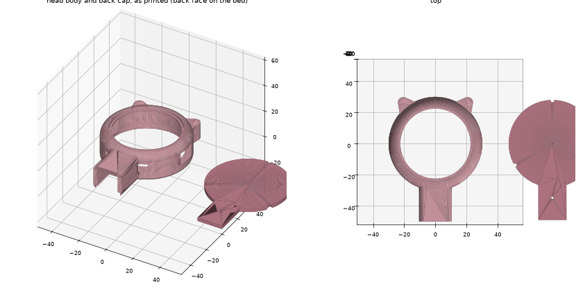
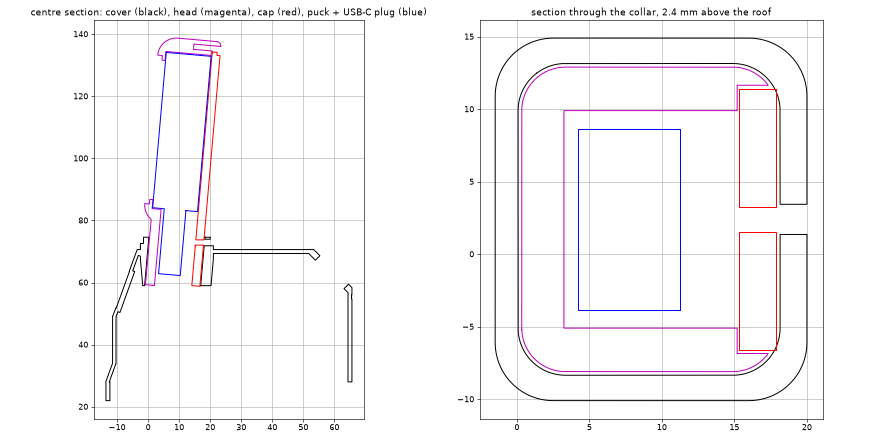

# Aurora Head top cover

A top cover and head shell for the **Waveshare ESP32-S3-Touch-AMOLED-1.43C** (the cased round board, Ø50.2 × 14.5 mm) running the [head firmware](../../../../../firmware/head-firmware/README.md). The round AMOLED becomes a big cat-eared head on a short neck at the front of the body, looking slightly up. The old OLED window on the front face is filled in.

Everything below the roof line is the stock **No-Ears v100** cover, so hip and knee travel are unchanged. The head floats 8 mm above the roof and its lowest points over the sides are more than 25 mm above the hip joints.

## Parts

| Part | File | Supports | Notes |
| --- | --- | --- | --- |
| Top cover | [Top-Cover-Aurora-v100.stl](Top-Cover-Aurora-v100.stl) | Yes, same as the other covers (inner top face only) | Stock No-Ears cover + neck collar, OLED window filled |
| Head body | [Aurora-Head-Body-v100.stl](Aurora-Head-Body-v100.stl) | No | Prints as exported: back face on the bed, bezel up |
| Head back cap | [Aurora-Head-Back-Cap-v100.stl](Aurora-Head-Back-Cap-v100.stl) | No | Flat disc with a tongue that closes the neck slot |
| Assembly | [Aurora-Head-Assembly-v100.glb](Aurora-Head-Assembly-v100.glb) | – | For viewing only (body frame + cover + head + display) |

Print the head parts in the orientation they are exported in. The puck pocket's bezel lip is a 2.9 mm ring overhang over the pocket and the button windows bridge 14 mm, both fine in PLA without supports. The front round-over is on top, so it comes out smooth. Use 3 walls on the head body so the M2 holes in the 4 mm pocket wall have enough plastic.

## Hardware you need

- 3 × M2 × 6 mm self-tapping screws (back cap)
- 1 × M2 × 8 mm self-tapping screw (locks the neck into the collar, from the back)
- A short USB-C cable with a slim overmould, at most **12.5 × 7 mm**, straight. Longer plugs are fine, the slot runs the full length of the neck into the body.
- 3 thin wires for TXD / RXD / GND, soldered to the pads inside the head case as described in the head firmware README

## Assembly

1. Solder the three UART wires to the pads next to the puck's USB-C port and route them out past the port.
2. Plug the USB-C cable into the puck. Feed the cable and wires down the open slot in the back of the neck, then lower the puck into the pocket from the back, **USB-C port at the bottom**. The two side buttons line up with the windows at 3 and 9 o'clock either way round.
3. Fit the back cap: its tongue lies along the back of the neck and closes the slot. Three M2 × 6 screws, do not over-tighten.
4. Push the neck into the collar on the cover, slot facing backwards. Pull the slack cable into the body through the hole in the roof.
5. Drive the M2 × 8 screw through the hole in the back of the collar; it passes through the tongue into the neck wall.
6. Connect the wires to the XIAO (D6/D7/GND) and the USB-C cable to the body's 5 V supply, then fit the cover as usual.

## Design notes

- Head shell Ø60 × 20 mm, 6 mm front round-over, puck pocket Ø50.8 with a Ø45 bezel opening (the panel's active area is Ø36.4, the glass is Ø48).
- The puck sits in a pocket open at the back, retained by the front bezel wall and the back cap. 0.3 mm clearance all round.
- Neck stem 21 × 17.5 mm with a 15 mm wide cable slot, 16 mm deep socket in the collar, 0.25 mm clearance per side. The collar continues 12 mm down inside the cover so the neck is held over a long length; it tapers to a 2 mm wall so it needs no extra supports beyond the usual inner-top-face ones.
- Face tilted up 5°, pivoting at the collar top.
- Small vents either side of the neck sit over the mic hole and speaker port on the bottom edge of the puck.
- The head adds roughly 40 g (display) plus about 25 g of print at the front, with its centre about 40 mm above the roof. Expect the front hips to work a little harder; check the stand and walk gaits on the bench before trusting it on a table edge.

## Remixing

The parts are generated by [`hardware/cad/aurora-head/generate_aurora_head.py`](../../../../cad/aurora-head/generate_aurora_head.py) (Python, `pip install trimesh manifold3d shapely`). Every dimension above is a named constant at the top of the script: ear shape and angle, tilt, neck height, clearances, screw positions. Run it to regenerate the three STLs and the assembly GLB, it also prints a clearance check of the display and USB-C plug against every part. Use it as the base for your own ears or a different head board.
