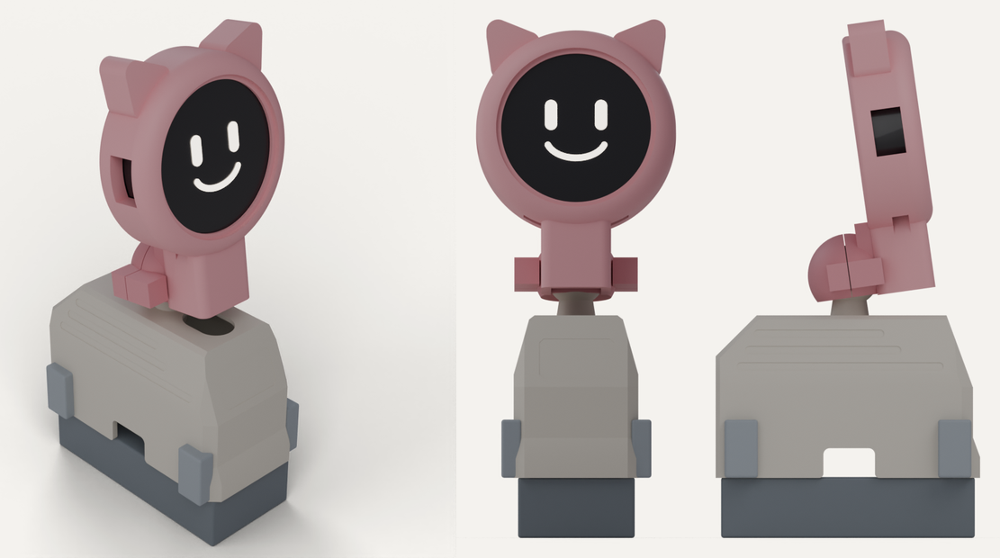
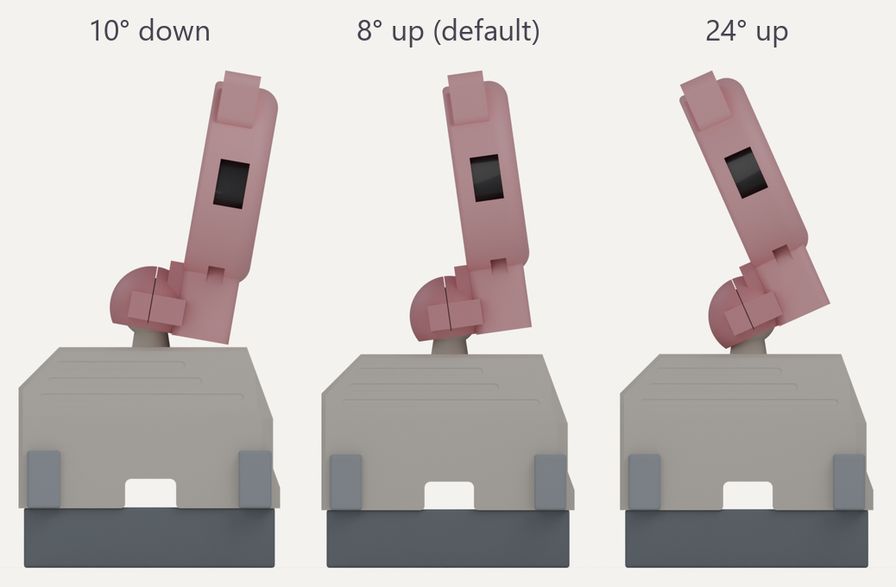
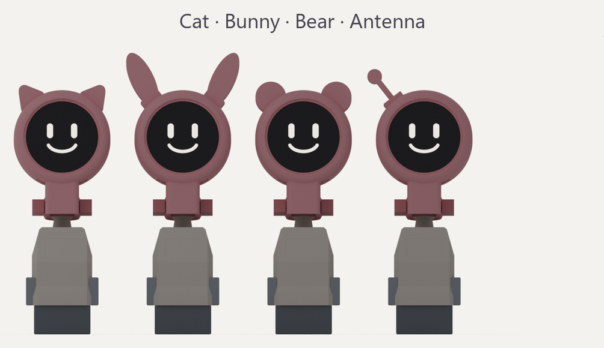
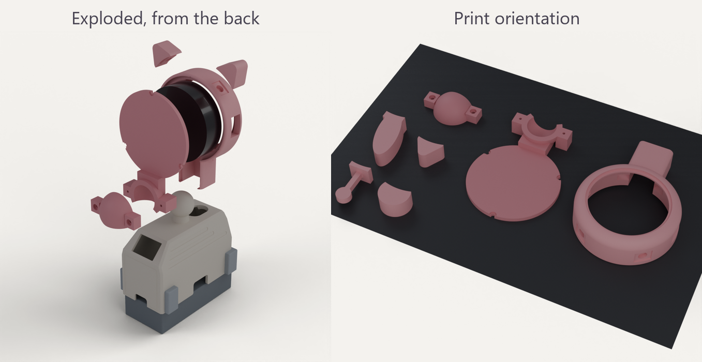

# Aurora Head top cover

A top cover and head for the **Waveshare ESP32-S3-Touch-AMOLED-1.43C** (the cased round board, Ø50.2 × 14.5 mm) running the [head firmware](../../../../../firmware/head-firmware/README.md). The round AMOLED becomes a big head on a **ball joint**, so you can set where it looks by hand, and the ears are **swappable** on magnets. The old OLED window on the front face is filled in.

Everything below the roof line is the stock **No-Ears v100** cover, stretched 15 mm taller, so hip and knee travel are unchanged.

## Moving the head

The head swivels on an Ø18 mm ball that sits just behind it on the roof. Two screws on a clamp at the back set how stiff the joint is. Tighten them until the head holds any angle but still moves by hand.

| Movement | Range |
| --- | --- |
| Tilt | 10° face down to 24° face up |
| Turn left / right | about ±25° (the joint turns freely; the cable sets the limit) |
| Lean sideways | about ±20° |

Past these angles the head touches the roof or the neck. The generator checks the whole range for collisions.

## Swappable ears

The head rim has two keyed sockets with a 5 × 2 mm magnet in each. Every ear has a matching key and magnet, so it clicks into place and can't spin. Print one ear file **twice** for a pair, and flip one of the two over when you fit it. The antenna is a single piece for the left socket.

## Parts

| Part | File | Supports | Notes |
| --- | --- | --- | --- |
| Top cover | [Top-Cover-Aurora-v200.stl](Top-Cover-Aurora-v200.stl) | Yes, same as the other covers (inner top face only) | Stock No-Ears cover + 15 mm, ball and neck on the roof, cable slot, OLED window filled |
| Head body | [Aurora-Head-Body-v200.stl](Aurora-Head-Body-v200.stl) | No | Back face on the bed, bezel up |
| Back cap | [Aurora-Head-Back-Cap-v200.stl](Aurora-Head-Back-Cap-v200.stl) | No | Flat face on the bed. Holds the front half of the ball socket |
| Socket clamp | [Aurora-Head-Socket-Clamp-v200.stl](Aurora-Head-Socket-Clamp-v200.stl) | No | Flat face on the bed. Rear half of the ball socket |
| Cat ears | [Aurora-Ear-Cat-v200.stl](Aurora-Ear-Cat-v200.stl) | No | Print 2 |
| Bunny ears | [Aurora-Ear-Bunny-v200.stl](Aurora-Ear-Bunny-v200.stl) | No | Print 2 |
| Bear ears | [Aurora-Ear-Bear-v200.stl](Aurora-Ear-Bear-v200.stl) | No | Print 2 |
| Antenna | [Aurora-Ear-Antenna-v200.stl](Aurora-Ear-Antenna-v200.stl) | No | Print 1 |
| Assembly | [Aurora-Head-Assembly-v200.glb](Aurora-Head-Assembly-v200.glb) | – | For viewing only |

Print every part in the orientation it is exported in. The domes inside the cap and clamp print without supports. Use 3 walls on the head body and the cap so the M2 holes have enough plastic. PETG is a good choice for the cover, because the neck carries the head.

## Hardware you need

- 3 × M2 × 6 mm self-tapping screws (back cap)
- 2 × M2 × 12 mm self-tapping screws (socket clamp)
- 1 × M3 × 16 mm self-tapping screw, optional. It goes up through the neck from inside the cover and stiffens it.
- 5 × 2 mm disc magnets: 2 for the head, plus 2 for each pair of ears and 1 for the antenna
- A short USB-C cable with a slim straight plug, at most **12.5 × 7 mm** and 22 mm long. The far end must fit through a 12 mm slot in the roof, so use bare wires or a small connector.
- 3 thin wires for TXD / RXD / GND, soldered to the pads inside the head case as described in the head firmware README

## Assembly

1. Glue the magnets into the head rim and the ears. Put both head magnets in with the same pole facing out, and the ear magnets the other way round, so every ear fits either socket. Check by stacking magnets before the glue sets.
2. Solder the three UART wires to the pads next to the puck's USB-C port and plug in the USB-C cable.
3. Lower the puck into the head from the back, **USB-C port at the bottom**. The plug slides down the open channel in the chin, and the cable and wires come out of its lower end. The two side buttons line up with the windows at 3 and 9 o'clock.
4. Fit the back cap. Its tongue closes the channel. Fit three M2 × 6 screws and don't over-tighten them.
5. Optional: drive the M3 × 16 screw up through the hole under the roof into the neck.
6. Feed the cable and wires down through the slot in the roof. Hold the head just in front of the ball and push it back, so the ball sits in the half socket on the cap.
7. Put the clamp behind the ball and fit the two M2 × 12 screws. Tighten them evenly until the head holds its angle.
8. Connect the wires to the XIAO (D6/D7/GND) and the USB-C cable to the body's 5 V supply, then fit the cover as usual.
9. Click on a pair of ears.

## Design notes

- Head shell Ø60 × 20 mm, 6 mm front round-over, puck pocket Ø50.8 with a Ø45 bezel opening (the panel's active area is Ø36.4, the glass is Ø48). 0.3 mm clearance around the puck.
- Ball Ø18 on a Ø10 to 12 mm neck, 12 mm above the roof. The socket is Ø18.1 and split through the ball's centre. The clamp stands 0.3 mm proud of the cap, so the screws squeeze the ball rather than closing a gap.
- The ball sits behind the USB-C plug, not under it. That keeps the plug's straight path down the chin and puts the cable straight into the body.
- The head centre is 53 mm above the roof, 15 mm higher than v100. The chin with the plug in it has to clear the roof across the whole tilt range.
- Small vents beside the chin sit over the mic hole and speaker port on the puck's bottom edge.
- Ear sockets are a 10 × 8 × 1 mm recess with a magnet pocket under it, 38° either side of the top. The bunny ears lean inwards. One file makes both sides because the part is flipped over for the left socket.
- The head adds roughly 40 g (display) plus about 30 g of print, centred about 50 mm above the roof and slightly ahead of the ball. Check the stand and walk gaits on the bench before trusting it on a table edge.

v100 (the cat-eared head on a fixed stem) is in the git history. The ten concept heads that were compared before settling on the ball joint and magnet ears are in [design-options.md](design-options.md), and the electronics side of the build is in [docs/two-brain-build](../../../../../docs/two-brain-build/README.md).

## Remixing

The parts are generated by [`hardware/cad/aurora-head/generate_aurora_head.py`](../../../../cad/aurora-head/generate_aurora_head.py) (Python, `pip install trimesh manifold3d shapely`). Every dimension above is a named constant at the top of the script, including the ball size, joint position, clamp, ear sockets and ear shapes. Adding an ear means adding one outline to `ear_profile()`. Run it to regenerate the STLs and the assembly GLB (`--ears bunny`, `--tilt 20` change what the GLB shows). It also prints a check of the display and USB-C plug against every part, and of the head against the cover across the tilt range.
