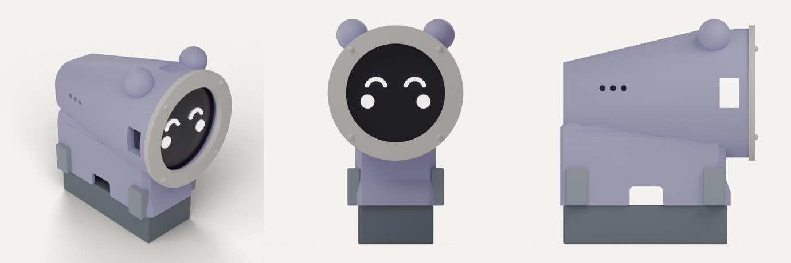
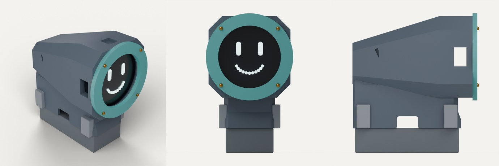
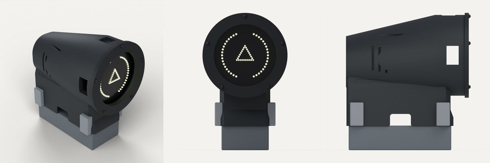
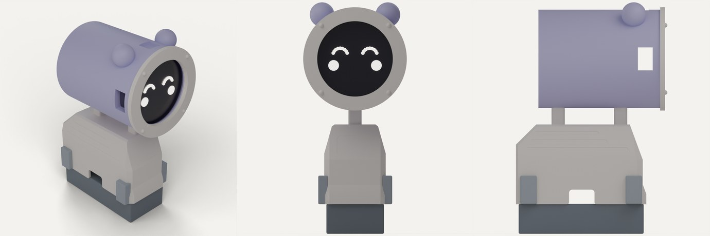
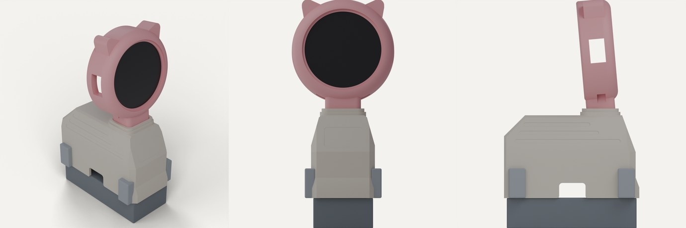
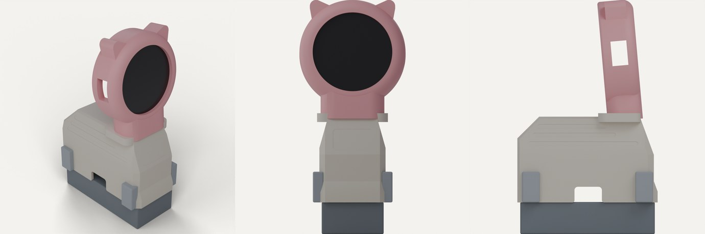
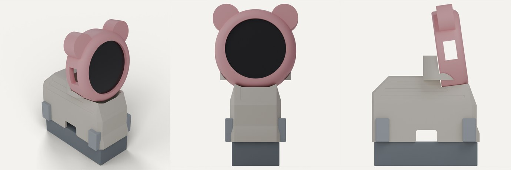
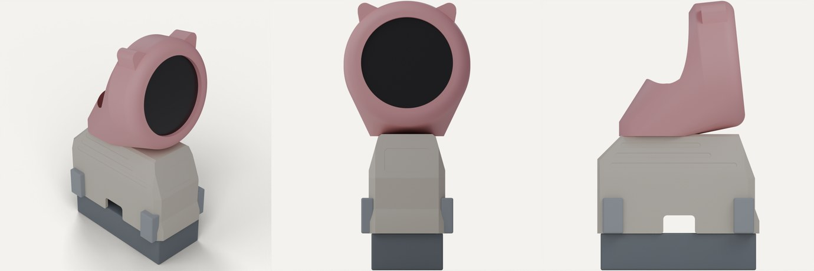
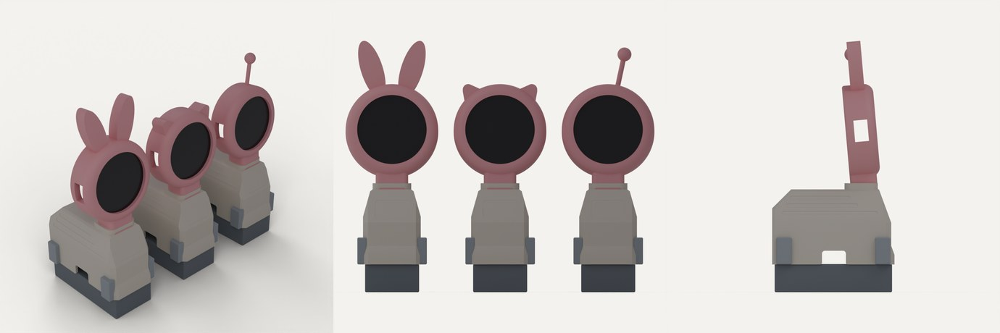
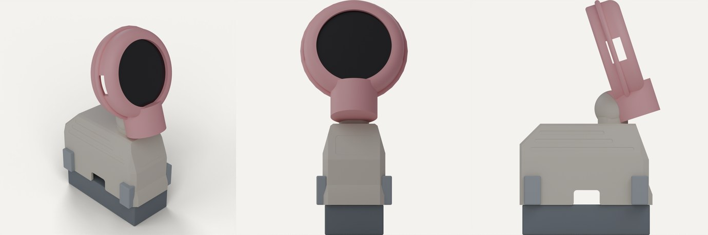

# Aurora head: the ten concepts

Before the [Aurora head v200](README.md) was built, ten concept heads were rendered for the Ø50.2 × 14.5 mm Waveshare 1.43C display puck, all on the stock No-Ears cover stretched by 15 mm. Each render shows iso, front and side views. The grey block is the chassis and the light grey posts are the hip envelope (top at Y 39.4 mm), so clearance and proportions can be judged.

These were massing concepts, not printable parts. The design that shipped combines **F (ball-joint tilt)** with **E (swappable magnet ears)** on top of the **A/B** round-head-on-top layout. The notes are kept here for anyone who wants to build one of the other shapes from the [generator](../../../../cad/aurora-head/generate_aurora_head.py).

## Family 1: face forward, barrel nose

The display faces straight ahead as the front end of a long cover, held by a separate screwed bezel ring. The barrel is Ø60 with its bottom 5 mm above the hips, reaching 8 mm in front of the stock cover.

Two issues apply to G, H and I:

- **USB-C.** The puck's USB-C sits on its rim, so the plug leaves radially. With the face forward, a straight plug hangs about 22 mm below the barrel, in front of the chassis. These need a right-angle USB-C plug that turns back into the body, or the puck must sit higher.
- **Balance.** The barrel puts the 40 g display about 10 mm ahead of the front hips, so the front legs work harder than with the neck designs.

### G · Hamster loaf

A soft barrel that melts into a domed back, with round ears and three dot vents. Closest match to the purple reference images.

| | |
| --- | --- |
| Printability | Split into nose (prints face-down, no supports) and loaf cover (roof-up, usual supports). Ears glue or magnet on |
| Generator change | New barrel builder plus a hull-blended cover top. Bezel ring becomes its own STL |
| Feel | Cute, toy-like, very friendly |

### H · Mecha

Chamfered, faceted body with slash grooves on the flank, panel lines on top and two latch tabs. Teal bezel with four exposed screw heads.

| | |
| --- | --- |
| Printability | Flat facets print cleanly. Grooves are 1.6 to 2.2 mm wide, fine for a 0.4 nozzle. Two-colour look by printing the bezel separately |
| Generator change | Octagonal hull instead of a round barrel. Grooves and tabs are simple boolean boxes |
| Feel | Industrial, game-robot |

### I · Sentinel

Smooth dark tube with a long swept back and sculpted grooves. Five-screw bezel. Suits a HUD-style face on the AMOLED.

| | |
| --- | --- |
| Printability | Same split as G. Best in matte black PLA or PETG |
| Generator change | Same as G with different groove cuts and no ears |
| Feel | Sleek, sci-fi drone |

### J · Cannon on stilts

The whole head is a closed cylinder on two posts above the stock roof. The body cover stays stock.

| | |
| --- | --- |
| Printability | Cylinder prints standing on its back end, no supports. Posts are part of the cover |
| Generator change | Smallest change in this family: tube part plus two post sockets on the roof |
| Feel | Playful, but tall and top-heavy |
| Cable bonus | The USB-C plug points straight down between the posts into a roof hole, so a normal straight cable works |

## Family 2: round head on top

The puck sits on top of the body facing forward. A was the first generator output; the rest change one idea each.

### A · Slim stem, cat ears

Ø60 head on a 21 × 17.5 mm stem in a deep collar, tilted up 5°. This was the first printable version.

### B · Chunky short neck

A wide 36 mm neck, 2 mm lower overall. Reads more like the original sketch and is stiffer. Constants only: stem size and neck height.

### C · Sunken saddle, bear ears

No neck. The head drops into a cradle behind it, 11 mm lower than A, so the centre of mass is lower. The cradle is part of the cover; the curved seat needs supports under its lip. The USB-C plug drops straight into the body.

### D · Hood sweep

The head shell flows back over the roof like a hood, in one continuous curve. Hollow hood prints face-up with supports inside; a large part. Hull of head disc and a roof pad, shelled, with the cable inside the hood.

### E · Swappable ears

One head with magnet-mounted ear sets: bunny, cat and a single antenna. Works with any option here. Ears print flat; 5 × 2 mm magnets press into the head rim and each ear. **Adopted in v200.**

### F · Ball-joint tilt

A ball on the roof and a socket in the head, so the face angle is set by hand. The ball needs a hollow core for the cable, and the friction fit needs a test print or two. The most work in this family. **Adopted in v200** with an Ø18 ball and a two-screw clamp.
